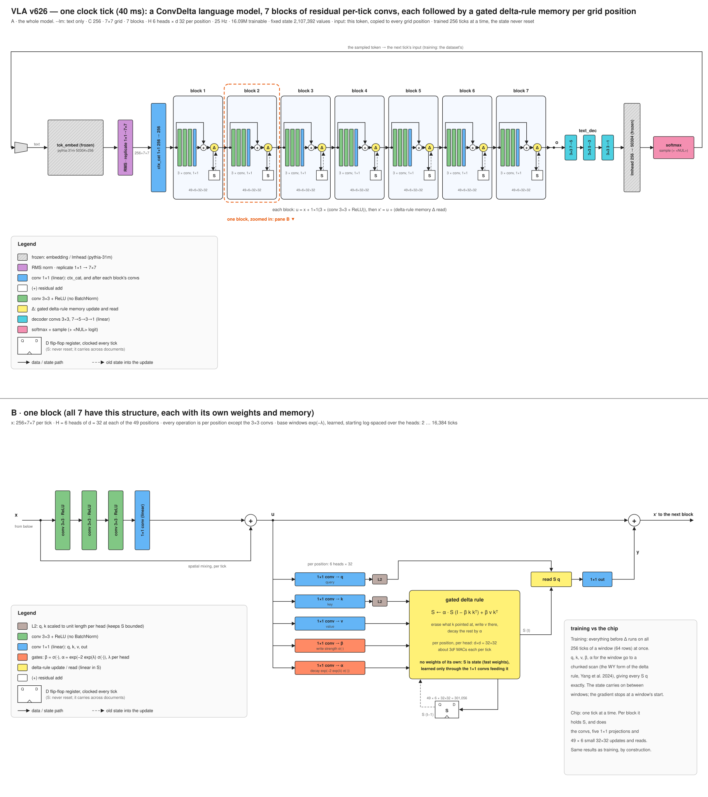

# VLA: a recurrent CNN vision-language-action model

`vla.py` is a language model with a fixed-size state and no positional encoding, built from convolutions on a
7 × 7 grid. The published model, v626, is a ConvDelta model. Its input is only the current token, copied to
every grid position. Seven residual blocks follow, each three 3 × 3 convolutions (no normalization) and a 1 × 1 around a skip, then
an associative memory at every grid position (6 heads of 32 × 32) written by the gated delta rule. Every clock
tick the model reads one token, updates its memories, and decodes the next token.

Most commercial applications for autonomous, agile robots do not require superintelligence. They need
conversational common sense, grounded in and modulated by what the device perceives: sound, video, touch. To
achieve superhuman hand-eye coordination, they need it at frame rates up to 500 Hz, with low and deterministic
latency, so the model can sit inside an embedded control loop, and on a power budget a battery can supply.

That rules out a large model streaming its weights from external DRAM. The design target is a
vision-language-action model on a single chip: a CNN is parameter-efficient enough that every weight fits in
on-chip SRAM, so there is no external memory, and the weights stay programmable. Leaving out external memory also
saves power: there are no DRAM chips to keep refreshed and no high-speed interface driving signals between chips,
and reading a weight from on-chip SRAM takes on the order of a hundred times less energy than fetching it from
off-chip DRAM. One set of small convolution kernels is reused at every grid position and every tick, so about
sixteen million trained weights drive a state of 2.1 million values. And the state never grows, so every tick does the
same work in the same time, however long the model has been running.



*One clock tick of the published model, v626. Top: the whole model, text only: the current token on every
position of the 7 × 7 grid, seven ConvDelta blocks, and the decoder. Bottom: one block, three 3 × 3 convs and a
1 × 1 around a skip, then a gated delta-rule memory at every grid position. The [functional spec](docs/spec/README.md) walks through the
figure part by part.*

- **Model:** [huggingface.co/siliconperception/vla](https://huggingface.co/siliconperception/vla)
- **Page:** [siliconperception.github.io/vla](https://siliconperception.github.io/vla/)
- **Functional spec:** [docs/spec](docs/spec/README.md)
- **Paper:** in preparation ([paper/](paper/))

## Quickstart

```bash
git clone https://github.com/siliconperception/vla && cd vla
pip install -r requirements.txt

# generate from the published weights (downloads ~170 MB once)
for p in "The colors of the rainbow are" \
         "The best way to learn a new language is" \
         "My grandmother's recipe for apple pie starts with" \
         "When you plant a vegetable garden, the first thing to do is" \
         "The history of the bicycle began in"; do
  python vla.py --pretrained --generate --n 120 --prompt "$p" --device cuda
done

# score them on held-out text (FineWeb is streamed from the Hugging Face hub)
python vla.py --pretrained --eval --eval_corpora fineweb --eval_docs 100 --device cuda
```

`--pretrained` restores the weights and every setting they were trained with. `--device cpu` works too, more
slowly.

## How it works

Each tick (see [docs/spec](docs/spec/README.md) for the exact computation):

1. The current token is embedded, RMS-normalized and copied to all 49 positions of the 7 × 7 grid, then mixed
   by a 1 × 1 convolution (256 → 256). Earlier tokens reach the model only through its memories.
2. Seven ConvDelta blocks, in series. Each block:
   - applies three 3 × 3 convolutions with ReLU (no normalization) and a linear 1 × 1 convolution, around a
     skip, giving u;
   - at every grid position, computes 6 heads of query q, key k, value v (1 × 1 convolutions; q and k unit
     length), a write strength β and a decay α;
   - updates each head's 32 × 32 memory M by the gated delta rule, M ← α M (I − β k kᵀ) + β v kᵀ: decay,
     erase what was stored at key k, write v there;
   - reads M q and adds it to u through a 1 × 1 convolution.
3. A small tree of convolutions collapses the last block's grid to one vector, and a frozen output layer gives
   the next-token probabilities.

No convolution reads the state; only the memories carry over from tick to tick. So in training the convolutions
run on all 256 ticks of a window at once, and the memories are trained over the window by an exact chunked
parallel scan (the WY form of the delta rule). The state carries on between windows. On a chip the model runs
one tick at a time, with the same result, and every conv streams row by row from a few-row line buffer.

In training the state is never reset (`--reset_prob 0`): at a document start the previous document's memories
carry on, and the model must learn to drop them itself, as a robot's continuous perception jumps between scenes.

## Training your own

```bash
# v626's configuration from scratch: text from FineWeb (sample-10BT), 64 rows x 256-tick windows, no
# BatchNorm, AdamW with the learning rate warmed from 0 to 3e-4 over 20,000 steps, then held; a running
# average of the weights (time constant 300 updates) is kept and evaluated alongside the live weights
python vla.py --mix fineweb:1 --shards 14 --shard_offset 1 --lm --context 7 --n_hidden 256 --c_context 256 \
    --linout_kernel 0 --attn 0 --convdelta 7 --cd_heads 6 --cd_dim 32 --cd_taps 0 --cd_convs 3 --cd_chunk 32 \
    --cd_mix_out --cd_mem_res --cd_no_gp --cd_no_bn --cd_windows 2:16384 --grid_hist 0 \
    --batch 64 --bptt 256 --ckpt_ticks --reset_prob 0 --clock_hz 25 --nul_weight 1 --loss_norm words \
    --optimizer adamw --betas 0.9,0.95 --weight_decay 0 --weight_ema 300 \
    --schedule coswarm --lr_min 0 --lr_max 0.0003 --lr_period 20000 \
    --save checkpoint/my_run.pt --log log/exp.my_run
```

The published weights continued from this run's step 2,926,848: the learning rate lowered to 1e-4, then from
step 3,232,512 about 480,000 steps of plain SGD (learning rates mostly 0.03 to 0.1; above about 0.13 it
diverged), then AdamW again from step 3,716,096, the learning rate warmed from 0 to 1e-3 and held, with
weight decay 0.1 from step 4,134,912 (`--weight_decay 0.1`). The published weights are the running average at step 6,160,000
(`--use_ema 300` on `--load` gives the same weights from a checkpoint); `--load` resumes a checkpoint with its
optimizer state and its average.

The same `vla.py` also trains the earlier register models (`--ctx_ema`, `--write_gate`, `--layers`) and
multimodal runs (`--mix` with image and video corpora, `--streams 3`). `tools/run.sh` is the launcher used for
every published run: it records the full command line and keeps the log and checkpoint names in step. Local
corpora (BabyLM, image and video features) are built by the `tools/*_prep.py` scripts under `$VLA_DATA`
(default `/data`).

## Repository

| Path | What |
|---|---|
| `vla.py` | model, training, evaluation, generation, hub export (`--push`) and import (`--pretrained`) |
| `tools/` | launcher, watchers, data preparation, reference scoring, figures, release pages |
| `docs/` | this project's web page, figures and functional spec |
| `paper/` | the white paper (in preparation) |
| `tests/` | smoke test |
| `archive/` | earlier Silicon Perception projects (IE120R image encoder, DX120P pose decoder, CNN_LM), kept for reference |

## Built on

- Gated delta rule: S. Yang, J. Kautz, A. Hatamizadeh, [Gated Delta Networks: Improving Mamba2 with Delta Rule](https://arxiv.org/abs/2412.06464) (2024)
- Chunked parallel training of the delta rule: S. Yang et al., [Parallelizing Linear Transformers with the Delta Rule over Sequence Length](https://arxiv.org/abs/2406.06484) (2024)
- Delta-rule fast weights: I. Schlag, K. Irie, J. Schmidhuber, [Linear Transformers Are Secretly Fast Weight Programmers](https://arxiv.org/abs/2102.11174) (2021)
- Matrix-valued recurrent state: A. Katharopoulos et al., [Transformers are RNNs: Fast Autoregressive Transformers with Linear Attention](https://arxiv.org/abs/2006.16236) (2020)
- Data-dependent decay per head: T. Dao, A. Gu, [Transformers are SSMs](https://arxiv.org/abs/2405.21060) (Mamba-2, 2024)
- Short causal conv before the memory: D. Y. Fu et al., [Hungry Hungry Hippos](https://arxiv.org/abs/2212.14052) (2022); A. Gu, T. Dao, [Mamba](https://arxiv.org/abs/2312.00752) (2023)
- A state at every position of a conv grid: X. Shi et al., [Convolutional LSTM Network](https://arxiv.org/abs/1506.04214) (2015)
- Residual blocks: K. He et al., [Deep Residual Learning for Image Recognition](https://arxiv.org/abs/1512.03385) (2015); RMS norm: B. Zhang, R. Sennrich, [Root Mean Square Layer Normalization](https://arxiv.org/abs/1910.07467) (2019)
- Tokenizer, frozen embedding and output layer, reference model: S. Biderman et al., [Pythia](https://arxiv.org/abs/2304.01373) (2023)
- Optimizer: I. Loshchilov, F. Hutter, [Decoupled Weight Decay Regularization](https://arxiv.org/abs/1711.05101) (2017); weight averaging: B. T. Polyak, A. B. Juditsky, [Acceleration of Stochastic Approximation by Averaging](https://doi.org/10.1137/0330046) (1992); data: G. Penedo et al., [The FineWeb Datasets](https://arxiv.org/abs/2406.17557) (2024)

## License

MIT, Copyright (c) 2024-2026 Silicon Perception Inc. See [LICENSE](LICENSE). The license covers the software and
the published weights; it grants no patent rights (see [PATENTS](PATENTS)). The published model includes frozen
third-party weights: the token embedding and output layer of EleutherAI's
[pythia-31m](https://huggingface.co/EleutherAI/pythia-31m) (Apache-2.0). Image runs (`--image_encoder`) add a
frozen ResNet-50 from [timm](https://huggingface.co/timm/resnet50.a1_in1k) (Apache-2.0).
