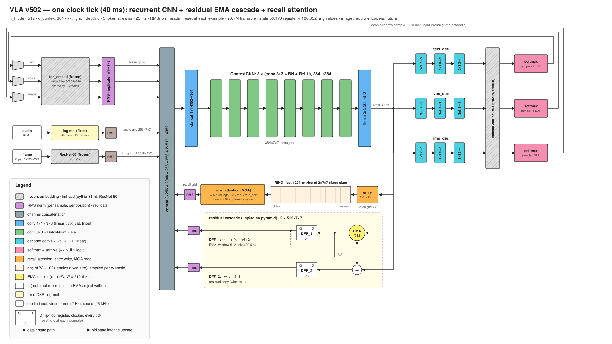

# VLA: a recurrent CNN vision-language-action model

`vla.py` is a language model with a fixed-size state and no positional encoding. Its memory is two 2-D register
grids of 512 × 7 × 7 and a ring holding a small entry for each of the last 1,024 ticks. Every clock tick, one
convolutional network reads the current token (and, in multimodal runs, the current image and sound), the
registers and one attention read of the ring, writes the registers back and appends a new entry to the ring.

The intended applications do not need superintelligence. They need conversational common sense, grounded in and
modulated by what the device perceives: sound, video, touch. But they need it fast: frame rates up to 500 Hz,
with low and deterministic latency, so the model can sit inside an embedded control loop, and on a power budget a
battery can supply.

That rules out a large model streaming its weights from external DRAM. The design target is a
vision-language-action model on a single chip: a CNN is parameter-efficient enough that every weight fits in
on-chip SRAM, so there is no external memory, and the weights stay programmable. One set of small convolution
kernels is reused at every grid position and every tick, so about twenty million weights drive a state of
150,528 values. And the state never grows, so every tick does the same work in the same time, however long the
model has been running.



*One clock tick of the published model, v502: three token streams (text, voice, image), two registers (a
512-tick average and a one-tick copy) and a recall ring of the last 1,024 ticks read by one attention step. The
image encoder is drawn as the design intends; v502 is trained on text.*

- **Model:** [huggingface.co/siliconperception/vla_v502](https://huggingface.co/siliconperception/vla_v502)
- **Page:** [siliconperception.github.io/vla](https://siliconperception.github.io/vla/)
- **Functional spec:** [docs/spec](docs/spec/README.md)
- **Paper:** in preparation ([paper/](paper/))

## Quickstart

```bash
git clone https://github.com/siliconperception/vla && cd vla
pip install -r requirements.txt

# generate from the published weights (downloads ~190 MB once)
for p in "The colors of the rainbow are" \
         "The best way to learn a new language is" \
         "My grandmother's recipe for apple pie starts with" \
         "When you plant a vegetable garden, the first thing to do is" \
         "The history of the bicycle began in"; do
  python vla.py --pretrained --generate --n 120 --prompt "$p" --device cuda
done

# prompt tuning: fit the starting registers (weights frozen) until the model predicts the prompt,
# then continue from them; prints the cold and the tuned continuation
python vla.py --pretrained --generate --prompt_tune 200 --n 120 --prompt "The colors of the rainbow are" --device cuda

# score them on held-out text (FineWeb is streamed from the Hugging Face hub)
python vla.py --pretrained --eval --eval_corpora fineweb --eval_docs 100 --device cuda
```

`--pretrained` restores the weights and every setting they were trained with. `--device cpu` works too, slowly.

## How it works

Each tick (see [docs/spec](docs/spec/README.md) for the exact computation):

1. The current token's embedding is RMS-normalized and broadcast over the 7 × 7 grid.
2. One attention read (8 heads sharing one key and value) recalls from the ring of the last 1,024 entries; the
   result is RMS-normalized and broadcast like the token. Slots carry no position or age.
3. Those grids, the sound grid (zeros for text) and the two registers, each RMS-normalized per position, are
   concatenated and mixed by a 1 × 1 convolution.
4. Eight 3 × 3 convolutions with BatchNorm and ReLU transform the result; a 3 × 3 convolution projects it to
   register width.
5. The registers are written as a cascade: the first moves 1/512 of the way toward the new output, the second
   holds the remainder, so the two always sum to it. A 1 × 1 convolution of the token and the output becomes the
   ring's newest entry; the oldest is dropped.
6. A small tree of convolutions collapses the grid to one vector, and a frozen output layer gives the next-token
   probabilities.

Training feeds one token per step to each of 250 rows and backpropagates through the last 16 steps (truncated
backpropagation through time, `--bptt 16`). Every document starts from a zero state.

## Training your own

```bash
# text from FineWeb (sample-10BT), 250 rows, from scratch, with v502's state: a 512-tick average, a
# one-tick copy, RMS-normalized reads and a 1,024-tick recall ring
python vla.py --dataset fineweb --batch 250 --context 7 --ctx_ema 512,1 --no-learn_win --read_rmsnorm \
    --attn 1024 --no-attn_age --linout_kernel 3 --bptt 16 --lr_max 0.02 --lr_min 4e-4 --loss_norm words \
    --save checkpoint/my_run.pt --log log/exp.my_run
```

`tools/run.sh` is the launcher used for every published run: it records the full command line and keeps the log
and checkpoint names in step. Local corpora (BabyLM, image and video features) are built by the `tools/*_prep.py`
scripts under `$VLA_DATA` (default `/data`).

## Repository

| Path | What |
|---|---|
| `vla.py` | model, training, evaluation, generation, hub export (`--push`) and import (`--pretrained`) |
| `tools/` | launcher, watchers, data preparation, reference scoring |
| `docs/` | this project's web page, figures and functional spec |
| `paper/` | the white paper (in preparation) |
| `tests/` | smoke test |
| `archive/` | earlier Silicon Perception projects (IE120R image encoder, DX120P pose decoder, CNN_LM), kept for reference |

## License

MIT, Copyright (c) 2024-2026 Silicon Perception Inc. See [LICENSE](LICENSE). The license covers the software and
the published weights; it grants no patent rights (see [PATENTS](PATENTS)). The published model includes frozen
third-party weights: the token embedding and output layer of EleutherAI's
[pythia-31m](https://huggingface.co/EleutherAI/pythia-31m) (Apache-2.0). Image runs (`--image_encoder`) add a
frozen ResNet-50 from [timm](https://huggingface.co/timm/resnet50.a1_in1k) (Apache-2.0).
