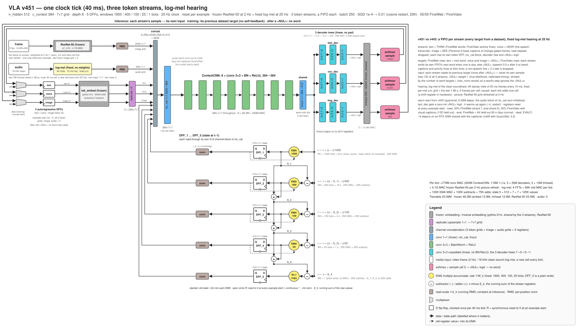

# VLA: a recurrent CNN vision-language-action model

`vla.py` is a language model with no attention and no positional encoding. Its memory is a small stack of
2-D register grids (here 5 registers of 512 × 7 × 7). Every clock tick, one convolutional network reads the
current token (and, in multimodal runs, the current image and sound) together with the registers, and writes
the registers back.

The design target is a vision-language-action model on a single chip running at 100 Hz or more. Single chip
means no external components: no off-chip memory, every weight stored on the chip itself. That is possible
because a CNN is parameter-efficient: one set of small convolution kernels is reused at every grid position
and every tick, so a few million weights drive a state of hundreds of thousands of values.



*One clock tick of the v451 design: three token streams (text, voice, image), a frozen image encoder at 2 Hz,
fixed log-mel hearing at 25 Hz, and the five-register cascade. The published model is trained on text.*

- **Model:** [huggingface.co/siliconperception/vla](https://huggingface.co/siliconperception/vla)
- **Page:** [siliconperception.github.io/vla](https://siliconperception.github.io/vla/)
- **Functional spec:** [docs/spec](docs/spec/README.md)
- **Paper:** in preparation ([paper/](paper/))

## Quickstart

```bash
git clone https://github.com/siliconperception/vla && cd vla
pip install -r requirements.txt

# generate from the published weights (downloads ~380 MB once)
python vla.py --pretrained --generate --n 100 --prompt "The little girl" --device cuda

# score them on held-out text (FineWeb is streamed from the Hugging Face hub)
python vla.py --pretrained --eval --eval_corpora fineweb --eval_docs 100 --device cuda
```

`--pretrained` restores the weights and every setting they were trained with. `--device cpu` works too, slowly.

## How it works

Each tick (see [docs/spec](docs/spec/README.md) for the exact computation):

1. The current token's embedding is RMS-normalized and broadcast over the 7 × 7 grid.
2. That grid, the image and sound grids (zeros for text) and the registers, each read at a fixed scale, are
   concatenated and mixed by a 1 × 1 convolution.
3. Eight 3 × 3 convolutions with BatchNorm and ReLU transform the result; a 1 × 1 convolution projects it to
   register width.
4. The registers are written as a cascade: each slow register moves a fraction 1/W of the way toward what the
   slower ones have not yet captured (W = 3200, 800, 200, 50 ticks), and the last register holds the remainder.
5. A small tree of convolutions collapses the grid to one vector, and a frozen output layer gives the next-token
   probabilities.

Training feeds one token per step to each of 250 rows and backpropagates through that step only: the registers
are not differentiated through time.

## Training your own

```bash
# text from FineWeb (sample-10BT), 250 rows, from scratch
python vla.py --dataset fineweb --batch 250 --save checkpoint/my_run.pt --log log/exp.my_run
```

`tools/run.sh` is the launcher used for every published run: it records the full command line and keeps the log
and checkpoint names in step. Local corpora (BabyLM, image and video features) are built by the `tools/*_prep.py`
scripts under `$VLA_DATA` (default `/data`).

## Repository

| Path | What |
|---|---|
| `vla.py` | model, training, evaluation, generation, hub export (`--push`) and import (`--pretrained`) |
| `tools/` | launcher, watchers, data preparation, reference scoring |
| `docs/` | this project's web page, figures and functional spec |
| `paper/` | the white paper (in preparation) |
| `tests/` | smoke test |
| `archive/` | earlier Silicon Perception projects (IE120R image encoder, DX120P pose decoder, CNN_LM), kept for reference |

## License

MIT, Copyright (c) 2024-2026 Silicon Perception Inc. See [LICENSE](LICENSE). The license covers the software and
the published weights; it grants no patent rights (see [PATENTS](PATENTS)). The published model includes frozen
third-party weights: the token embedding and output layer of EleutherAI's
[pythia-31m](https://huggingface.co/EleutherAI/pythia-31m) (Apache-2.0) and a ResNet-50 from
[timm](https://huggingface.co/timm/resnet50.a1_in1k) (Apache-2.0).
