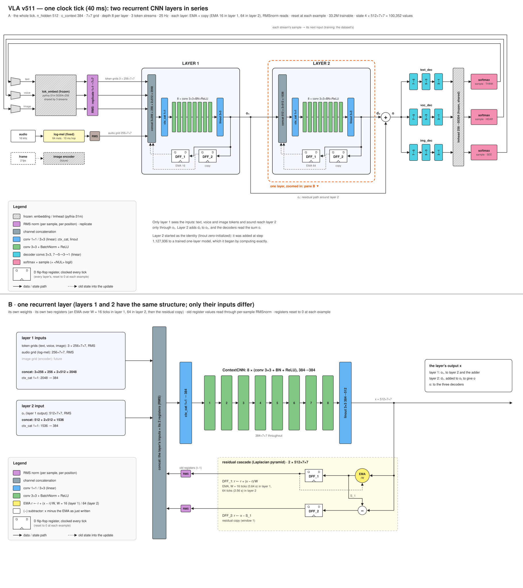

# VLA: a recurrent CNN vision-language-action model

`vla.py` is a language model with a fixed-size state and no positional encoding. It is two recurrent
convolutional layers in series, each with its own memory: two 2-D register grids of 512 × 7 × 7, a slow average
and a copy of the rest. Every clock tick, layer 1 reads the current token (and, in multimodal runs, the current
image and sound) and its registers; layer 2 reads layer 1's output and its own registers; each writes its
registers back, and the sum of the two layers' outputs is decoded into the next token.

Most commercial applications for autonomous, agile robots do not require superintelligence. They need
conversational common sense, grounded in and modulated by what the device perceives: sound, video, touch. To
achieve superhuman hand-eye coordination, they need it at frame rates up to 500 Hz, with low and deterministic
latency, so the model can sit inside an embedded control loop, and on a power budget a battery can supply.

That rules out a large model streaming its weights from external DRAM. The design target is a
vision-language-action model on a single chip: a CNN is parameter-efficient enough that every weight fits in
on-chip SRAM, so there is no external memory, and the weights stay programmable. Leaving out external memory also
saves power: there are no DRAM chips to keep refreshed and no high-speed interface driving signals between chips,
and reading a weight from on-chip SRAM takes on the order of a hundred times less energy than fetching it from
off-chip DRAM. One set of small convolution
kernels is reused at every grid position and every tick, so about thirty million weights drive a state of
100,352 values. And the state never grows, so every tick does the same work in the same time, however long the
model has been running.



*One clock tick of the published model, v511: three token streams (text, voice, image) and two recurrent layers
in series, each with two registers (a slow average, over 16 ticks in layer 1 and 64 in layer 2, and a one-tick
copy). The lower pane zooms into one layer. The image encoder is drawn as the design intends; v511 is trained on
text.*

- **Model:** [huggingface.co/siliconperception/vla](https://huggingface.co/siliconperception/vla)
- **Page:** [siliconperception.github.io/vla](https://siliconperception.github.io/vla/)
- **Functional spec:** [docs/spec](docs/spec/README.md)
- **Paper:** in preparation ([paper/](paper/))

## Quickstart

```bash
git clone https://github.com/siliconperception/vla && cd vla
pip install -r requirements.txt

# generate from the published weights (downloads ~340 MB once)
for p in "The colors of the rainbow are" \
         "The best way to learn a new language is" \
         "My grandmother's recipe for apple pie starts with" \
         "When you plant a vegetable garden, the first thing to do is" \
         "The history of the bicycle began in"; do
  python vla.py --pretrained --generate --n 120 --prompt "$p" --device cuda
done

# prompt tuning: fit the starting registers (weights frozen) until the model predicts the prompt,
# then continue from them; prints the cold and the tuned continuation
python vla.py --pretrained --generate --prompt_tune 200 --n 120 --prompt "The colors of the rainbow are" --device cuda

# score them on held-out text (FineWeb is streamed from the Hugging Face hub)
python vla.py --pretrained --eval --eval_corpora fineweb --eval_docs 100 --device cuda
```

`--pretrained` restores the weights and every setting they were trained with. `--device cpu` works too, slowly.

## How it works

Each tick (see [docs/spec](docs/spec/README.md) for the exact computation):

1. The current token's embedding is RMS-normalized and broadcast over the 7 × 7 grid.
2. Layer 1: that grid, the sound grid (zeros for text) and layer 1's two registers, each RMS-normalized per
   position, are concatenated and mixed by a 1 × 1 convolution. Eight 3 × 3 convolutions with BatchNorm and ReLU
   transform the result, and a 3 × 3 convolution projects it to register width: the output o₁.
3. Layer 2 does the same with its own weights, reading only o₁ and its own two registers. Its output d₂ is added
   to o₁.
4. Each layer writes its output into its registers as a cascade: the first moves 1/W of the way toward it (W = 16
   ticks in layer 1, 64 in layer 2), the second holds the remainder, so the two always sum to it.
5. A small tree of convolutions collapses o₁ + d₂ to one vector, and a frozen output layer gives the next-token
   probabilities.

Training feeds one token per step to each of 250 rows and backpropagates through the last 16 steps (truncated
backpropagation through time, `--bptt 16`). Every document starts from a zero state.

## Training your own

```bash
# text from FineWeb (sample-10BT), 250 rows, from scratch, with v511's architecture: two layers, a 16-tick
# average in layer 1 and a 64-tick average in layer 2, each with a one-tick copy and RMS-normalized reads
python vla.py --dataset fineweb --batch 250 --context 7 --layers 2 --ctx_ema 16,1 --up_ema 64,1 \
    --no-learn_win --read_rmsnorm --attn 0 --linout_kernel 3 --bptt 16 --lr_max 0.02 --lr_min 4e-4 \
    --loss_norm words --save checkpoint/my_run.pt --log log/exp.my_run
```

The published weights were not trained in one run like this: the configuration grew during training, each change
resuming from the latest weights ([docs/spec](docs/spec/README.md) lists the steps). Adding a layer to a trained
model starts it as the identity, so `--layers 2` on a one-layer checkpoint keeps its function.

`tools/run.sh` is the launcher used for every published run: it records the full command line and keeps the log
and checkpoint names in step. Local corpora (BabyLM, image and video features) are built by the `tools/*_prep.py`
scripts under `$VLA_DATA` (default `/data`).

## Repository

| Path | What |
|---|---|
| `vla.py` | model, training, evaluation, generation, hub export (`--push`) and import (`--pretrained`) |
| `tools/` | launcher, watchers, data preparation, reference scoring |
| `docs/` | this project's web page, figures and functional spec |
| `paper/` | the white paper (in preparation) |
| `tests/` | smoke test |
| `archive/` | earlier Silicon Perception projects (IE120R image encoder, DX120P pose decoder, CNN_LM), kept for reference |

## License

MIT, Copyright (c) 2024-2026 Silicon Perception Inc. See [LICENSE](LICENSE). The license covers the software and
the published weights; it grants no patent rights (see [PATENTS](PATENTS)). The published model includes frozen
third-party weights: the token embedding and output layer of EleutherAI's
[pythia-31m](https://huggingface.co/EleutherAI/pythia-31m) (Apache-2.0). Image runs (`--image_encoder`) add a
frozen ResNet-50 from [timm](https://huggingface.co/timm/resnet50.a1_in1k) (Apache-2.0).
