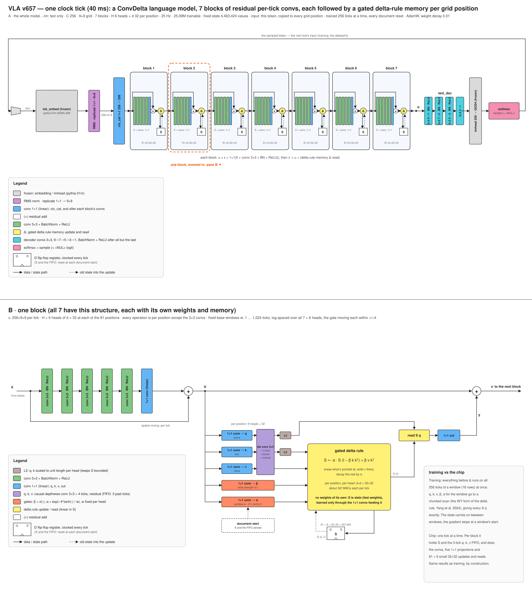

# VLA (ConvDelta)

**Release v657, step 3,700,000** (59.2 M training tokens).

A language model with a fixed-size state and no positional encoding, built from convolutions on a 9 × 9 grid. Its
input is only the current token, copied to every grid position. Seven residual ConvDelta blocks follow. Each one
is five 3 × 3 conv + BatchNorm + ReLU layers and a 1 × 1 conv around a skip, then, at every grid position, 6 heads
of a 32 × 32 associative memory written by the gated delta rule and read by a query. Each head forgets over a
fixed base window, from 1 to 1,024 ticks across the 42 heads, which the input can stretch or shrink up to 4×. Every
tick the model reads one token, updates its memories, and decodes the next token. The state, the memories and a
3-tick buffer of their inputs, is 4.5 M values that never grow.

It is the text-trained core of a vision-language-action design. Most commercial applications for autonomous,
agile robots do not require superintelligence; they need conversational common sense, grounded in and modulated by
what the device perceives (sound, video, touch). To achieve superhuman hand-eye coordination, they need it at frame
rates up to 500 Hz, with low and deterministic latency for embedded control, on a power budget a battery can
supply. So the target is a single chip with no external DRAM: a CNN is parameter-efficient enough that every weight
fits in on-chip SRAM, where the weights stay programmable, and the fixed-size state makes every tick the same work.
Leaving out external memory also saves power: no DRAM chips to keep refreshed, no high-speed interface driving
signals between chips, and a weight read from on-chip SRAM takes on the order of a hundred times less energy than
one fetched from off-chip DRAM.

Code, functional spec and figures: [github.com/siliconperception/vla](https://github.com/siliconperception/vla)



## Use

```bash
git clone https://github.com/siliconperception/vla && cd vla && pip install -r requirements.txt
for p in "The colors of the rainbow are" \
         "The best way to learn a new language is" \
         "My grandmother's recipe for apple pie starts with" \
         "When you plant a vegetable garden, the first thing to do is" \
         "The history of the bicycle began in"; do
  python vla.py --pretrained --generate --n 120 --prompt "$p" --device cuda
done
```

`--pretrained` downloads `model.safetensors` and `vla_args.json` (the settings the weights were trained with)
and restores both. The weights are not a `transformers` model; load them through `vla.py`. This repository
holds only the current release: each new one replaces the weights and this card, and earlier releases are not
kept.

## Model

| | |
|---|---|
| Parameters | 50.8 M: 25.1 M trained, 25.8 M frozen (token embedding and output layer from pythia-31m) |
| State | 4,463,424 values, fixed in size: per block 81 positions × 6 heads × 32 × 32 memories (3,483,648 in all) and the last 3 ticks of q, k, v (979,776) |
| Input | the current token, embedded (frozen), RMS-normalized, copied to all 81 positions, mixed 1×1 (256 → 256) |
| Blocks | 7 × ConvDelta at 256 channels: u = x + 1×1(5 × (3×3 conv, BatchNorm, ReLU)), then 1×1 q, k, v (plus a causal depthwise 3×3 conv over the last 4 ticks), β, α, a gated delta-rule memory per position and head, and x′ = u + 1×1 out(read) |
| Memory | M ← α M (I − β k kᵀ) + β v kᵀ, read M q; q, k unit length; β and α computed from the input every tick; α = exp(−4^tanh(g) / w) with a fixed base window w per head, log-spaced 1 to 1,024 ticks over the 42 heads, so each head's window stays within w/4 … 4w |
| Readout | a tree of four 3×3 convs (9 → 7 → 5 → 3 → 1, BatchNorm and ReLU after the first three) straight from the last block, the frozen pythia-31m output layer |
| Tokenizer | pythia-31m BPE (50,304) plus a `<NUL>` token ("say nothing this tick") |
| Compute | about 1.92 G multiply-accumulates per tick, the same every tick; every conv streams row by row |

## Training

- From scratch, in one run with one configuration: 3,700,000 steps, one token per row per step, 16 rows
  (59.2 M tokens, 14,453 optimizer updates). Each row trains on 256-tick windows, all ticks of a window at
  once (the memories through an exact chunked parallel scan); the state carries on between windows and the
  gradient stops at a window's start.
- AdamW (β 0.9, 0.95), learning rate warmed from 0 to 1e-3 over the first 20,000 steps and held; weight decay
  0.01, except on the β and α gates. No gradient clipping. The loss is normalized per word rather than per token.
- The published weights are a running average of the trained weights (an exponential moving average with a
  time constant of 300 updates, kept through the whole run), not the last update's weights. At 3,700,000 it scores
  about 0.12 nats per token lower on FineWeb-Edu than the weights it averages.
- Data: FineWeb-Edu sample-10BT (10 B tokens), text only, every document drawn in a fresh random order each pass;
  1 document in 32 (by a hash of its text) is held out. The state, memories and q, k, v buffer, is reset to zero
  at every document start, in training and evaluation.
- The [spec](https://github.com/siliconperception/vla/blob/main/docs/spec/README.md) gives the exact computation.

## Evaluation (at the published step, 3,700,000)

The reference is EleutherAI's [pythia-70m](https://huggingface.co/EleutherAI/pythia-70m): a transformer with the
same tokenizer, so losses per token compare directly. Its 70 M parameters include 19 M outside the token
embedding and output layer, comparable to this model's 25.1 M trained ones. Pythia publishes checkpoints from early in training, so it is
shown at about this model's training tokens (steps 16 and 32 bracket it) as well as fully trained. Every model is
scored on the same documents and pairs, by the same rule.

| | **this model** | pythia-70m | pythia-70m | pythia-70m |
|---|---|---|---|---|
| training tokens | **59.2 M** | 33.6 M (step 16) | 67.1 M (step 32) | 300 B (final) |
| FineWeb-Edu held-out (100 documents, nats/token) | **4.242** | 10.489 | 9.793 | 3.579 |
| FineWeb held-out (100 documents, nats/token) | **4.519** | 10.489 | 9.823 | 3.731 |
| BabyLM 2026 dev (100 pieces, nats/token) | **3.991** | 10.285 | 9.448 | 3.250 |
| BLiMP (1,005 pairs from all 67 paradigms), % | **71.8** | 53.5 | 52.0 | 75.7 |
| ComVE (999 pairs, common sense), % | **66.8** | 54.8 | 54.0 | 69.7 |

Losses are the mean over documents of each document's mean loss per token, from a zero state (this model) or a
bare document start (pythia); a document with any token over 20 nats is counted as a runaway and left out
(3 % of the FineWeb-Edu documents for this model). Pythia was trained on the Pile, this model on
FineWeb-Edu, so the FineWeb-Edu row is in-domain for this model only. Matched tokens are not matched training:
pythia's 33.6 M and 67.1 M tokens are only 16 and 32 optimizer updates of 2 M tokens each, at the start of its
learning-rate warm-up, while this model's are 14,453 updates of 4,096 tokens. Fully trained pythia-70m is the
fair reference: this model is still short of it, by about 0.7 nats per token on FineWeb-Edu and 3 to 4 points on
BLiMP and ComVE. A pair is right when the model gives the correct sentence the lower
total loss, each sentence read without context; chance is 50 %. For scale on the pairs: babyllama-10m-2024
(trained on 10 M words) scores 70.0 / 63.7 and SmolLM2-135M 80.9 / 79.3.

## Samples

From the prompt in bold, with these weights. Locally fluent in places, repetitive, not yet coherent:

> **The best way to learn a new language is** to change grammar and create a new language which will bring it along the way.

> **The history of the bicycle began in** 1972, when the first generation of wheelcar engine sold home for the first time, which after the first generation of electric cars became an electrical power.

## Limits

A small model very early in training: its text is often repetitive, not factual and not consistent. Not
instruction-tuned, not safety filtered beyond its training corpora. Text only.

## References

The model builds on the gated delta rule ([Yang, Kautz, Hatamizadeh 2024](https://arxiv.org/abs/2412.06464)),
its chunked parallel form ([Yang et al. 2024](https://arxiv.org/abs/2406.06484)) and the fast-weight view of
linear attention ([Schlag, Irie, Schmidhuber 2021](https://arxiv.org/abs/2102.11174);
[Katharopoulos et al. 2020](https://arxiv.org/abs/2006.16236)), with a per-head decay as in Mamba-2
([Dao, Gu 2024](https://arxiv.org/abs/2405.21060)). A state
at every position of a conv grid follows ConvLSTM ([Shi et al. 2015](https://arxiv.org/abs/1506.04214)); the
blocks use residual connections ([He et al. 2015](https://arxiv.org/abs/1512.03385)) and RMS normalization
([Zhang, Sennrich 2019](https://arxiv.org/abs/1910.07467)), batch normalization
([Ioffe, Szegedy 2015](https://arxiv.org/abs/1502.03167)), and a short causal conv before the memory as in H3 and
Mamba ([Fu et al. 2022](https://arxiv.org/abs/2212.14052); [Gu, Dao 2023](https://arxiv.org/abs/2312.00752)). Tokenizer, frozen embedding and output layer, and the
reference model: Pythia ([Biderman et al. 2023](https://arxiv.org/abs/2304.01373)). Optimizer: AdamW
([Loshchilov, Hutter 2017](https://arxiv.org/abs/1711.05101)); weight averaging
([Polyak, Juditsky 1992](https://doi.org/10.1137/0330046)). Data: FineWeb-Edu
([Penedo et al. 2024](https://arxiv.org/abs/2406.17557)).

## License

MIT, Copyright (c) 2024-2026 Silicon Perception Inc. The license covers the software and these weights and grants
no patent rights; see [PATENTS](https://github.com/siliconperception/vla/blob/main/PATENTS). Frozen third-party
weights inside: EleutherAI [pythia-31m](https://huggingface.co/EleutherAI/pythia-31m) embedding and output
layer (Apache-2.0).
