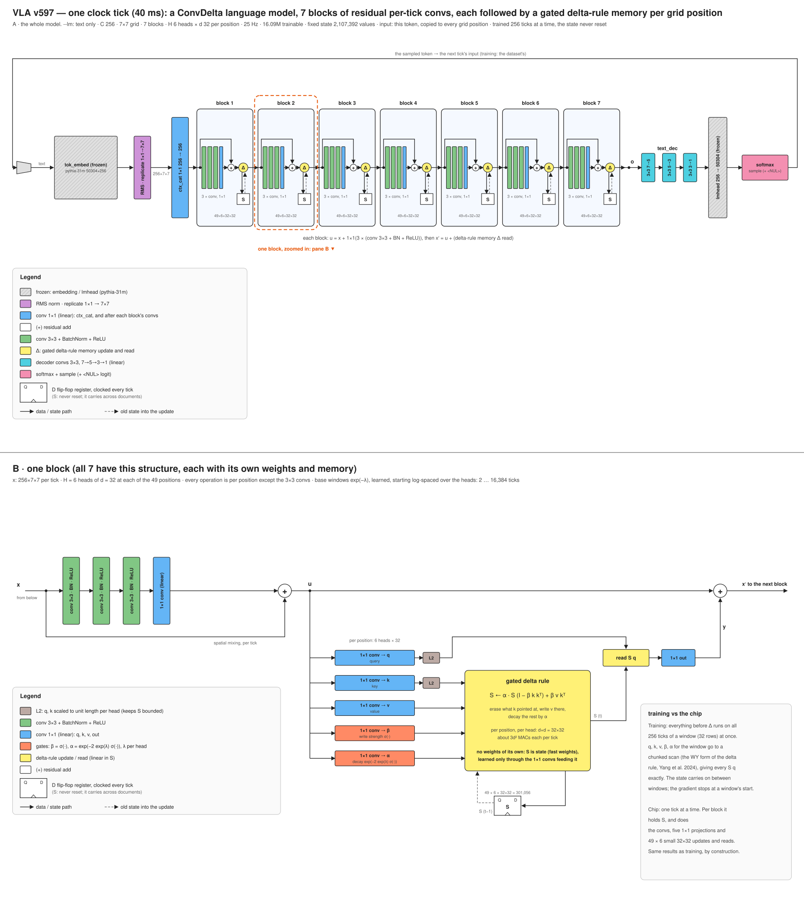

# VLA (ConvDelta)

**Release v597, step 4,160,000** (161.5 M training tokens).

A language model with a fixed-size state and no positional encoding, built from convolutions on a 7 × 7 grid. Its
input is only the current token, copied to every grid position. Seven residual ConvDelta blocks follow. Each one
is three 3 × 3 conv + BatchNorm + ReLU layers and a 1 × 1 conv around a skip, then, at every grid position, 6
heads of a 32 × 32 associative memory written by the gated delta rule and read by a query. Every tick the model
reads one token, updates its memories, and decodes the next token. The memories are the whole state: 2.1 M
values that never grow, and never reset in training.

It is the text-trained core of a vision-language-action design. Most commercial applications for autonomous,
agile robots do not require superintelligence; they need conversational common sense, grounded in and modulated by
what the device perceives (sound, video, touch). To achieve superhuman hand-eye coordination, they need it at frame
rates up to 500 Hz, with low and deterministic latency for embedded control, on a power budget a battery can
supply. So the target is a single chip with no external DRAM: a CNN is parameter-efficient enough that every weight
fits in on-chip SRAM, where the weights stay programmable, and the fixed-size state makes every tick the same work.
Leaving out external memory also saves power: no DRAM chips to keep refreshed, no high-speed interface driving
signals between chips, and a weight read from on-chip SRAM takes on the order of a hundred times less energy than
one fetched from off-chip DRAM.

Code, functional spec and figures: [github.com/siliconperception/vla](https://github.com/siliconperception/vla)



## Use

```bash
git clone https://github.com/siliconperception/vla && cd vla && pip install -r requirements.txt
for p in "The colors of the rainbow are" \
         "The best way to learn a new language is" \
         "My grandmother's recipe for apple pie starts with" \
         "When you plant a vegetable garden, the first thing to do is" \
         "The history of the bicycle began in"; do
  python vla.py --pretrained --generate --n 120 --prompt "$p" --device cuda
done
```

`--pretrained` downloads `model.safetensors` and `vla_args.json` (the settings the weights were trained with)
and restores both. The weights are not a `transformers` model; load them through `vla.py`. This repository
holds only the current release: each new one replaces the weights and this card, and earlier releases are not
kept.

## Model

| | |
|---|---|
| Parameters | 41.8 M: 16.1 M trained, 25.8 M frozen (token embedding and output layer from pythia-31m) |
| State | 2,107,392 values, fixed in size: per block 49 positions × 6 heads × 32 × 32 memories; nothing else |
| Input | the current token, embedded (frozen), RMS-normalized, copied to all 49 positions, mixed 1×1 (256 → 256) |
| Blocks | 7 × ConvDelta at 256 channels: u = x + 1×1(3 × (3×3 conv, BatchNorm, ReLU)), then 1×1 q, k, v, β, α, a gated delta-rule memory per position and head, and x′ = u + 1×1 out(read) |
| Memory | M ← α M (I − β k kᵀ) + β v kᵀ, read M q; q, k unit length; β, α computed from the input every tick; base decay windows 2 to 16,384 ticks |
| Readout | a tree of three 3×3 convs (7 → 5 → 3 → 1) straight from the last block, the frozen pythia-31m output layer |
| Tokenizer | pythia-31m BPE (50,304) plus a `<NUL>` token ("say nothing this tick") |
| Compute | about 0.74 G multiply-accumulates per tick, the same every tick; every conv streams row by row |

## Training

- From scratch: 4,160,000 steps, one token per row per step, 32 rows to step 608,512 and 40 after (161.5 M
  tokens, 16,250 optimizer updates). Each row trains on 256-tick windows, all ticks of a window at once (the
  memories through an exact chunked parallel scan); the state carries on between windows and the gradient stops
  at a window's start.
- AdamW (β 0.9, 0.9, no weight decay), learning rate warmed from 0 to 5e-4 over the first 20,000 steps, held,
  then lowered to 3e-4 from step 484,352 (over 20,000 steps) and held. The loss is normalized per word rather
  than per token.
- Data: FineWeb sample-10BT, text only. In training the state is never reset: at a document start the previous
  document's memories carry on, marked only by `<NUL>`, and the model must learn to drop them itself (as a
  robot's continuous perception jumps between scenes). Evaluation resets at every document.
- The [spec](https://github.com/siliconperception/vla/blob/main/docs/spec/README.md) gives the exact computation.

## Evaluation (at the published step, 4,160,000)

The reference is EleutherAI's [pythia-70m](https://huggingface.co/EleutherAI/pythia-70m): a transformer with the
same tokenizer, so losses per token compare directly. Its 70 M parameters include 19 M outside the token
embedding and output layer, close to this model's 16.1 M trained ones. Pythia publishes checkpoints from early in training, so it is
shown at about this model's training tokens (steps 64 and 128 bracket it) as well as fully trained. Every model is
scored on the same documents and pairs, by the same rule.

| | **this model** | pythia-70m | pythia-70m | pythia-70m |
|---|---|---|---|---|
| training tokens | **161.5 M** | 134.2 M (step 64) | 268.4 M (step 128) | 300 B (final) |
| FineWeb held-out (100 documents, nats/token) | **4.477** | 9.002 | 7.420 | 3.731 |
| BabyLM 2026 dev (100 pieces, nats/token) | **4.018** | 8.635 | 6.866 | 3.250 |
| BLiMP (1,005 pairs from all 67 paradigms), % | **70.5** | 52.7 | 51.8 | 75.7 |
| ComVE (999 pairs, common sense), % | **68.2** | 56.3 | 56.5 | 69.7 |

Losses are the mean over documents of each document's mean loss per token, from a zero state (this model) or a
bare document start (pythia); a document with any token over 20 nats is counted as a runaway and left out
(6 % of the FineWeb documents for this model). Pythia was trained on the Pile, this model on FineWeb, so
the FineWeb row is in-domain for this model only. Matched tokens are not matched training: pythia's 134.2 M and
268.4 M tokens are only 64 and 128 optimizer updates of 2 M tokens each, early in its learning-rate
warm-up, while this model's are 16,250 updates of 8,192 to 10,240 tokens. Fully trained pythia-70m is the fair
reference: this model is still well short of it in loss, and close to it on ComVE. A pair is right when the model gives the correct sentence the lower
total loss, each sentence read without context; chance is 50 %. For scale on the pairs: babyllama-10m-2024
(trained on 10 M words) scores 70.0 / 63.7 and SmolLM2-135M 80.9 / 79.3.

## Samples

From the prompt in bold, with these weights. Locally fluent in places, repetitive, not yet coherent:

> **My grandmother's recipe for apple pie starts with** a touch of me. She sounds wonderful. I already have a my favorite pie tasting bowl and I will always try again so I can get the recipe I love, I think more.

> **The history of the bicycle began in** 2001 by the founder of the National Park Service Project.

## Limits

A small model very early in training: its text is often repetitive, not factual and not consistent. Not
instruction-tuned, not safety filtered beyond its training corpora. Text only.

## References

The model builds on the gated delta rule ([Yang, Kautz, Hatamizadeh 2024](https://arxiv.org/abs/2412.06464)),
its chunked parallel form ([Yang et al. 2024](https://arxiv.org/abs/2406.06484)) and the fast-weight view of
linear attention ([Schlag, Irie, Schmidhuber 2021](https://arxiv.org/abs/2102.11174);
[Katharopoulos et al. 2020](https://arxiv.org/abs/2006.16236)), with a per-head decay as in Mamba-2
([Dao, Gu 2024](https://arxiv.org/abs/2405.21060)). A state
at every position of a conv grid follows ConvLSTM ([Shi et al. 2015](https://arxiv.org/abs/1506.04214)); the
blocks use residual connections ([He et al. 2015](https://arxiv.org/abs/1512.03385)), BatchNorm
([Ioffe, Szegedy 2015](https://arxiv.org/abs/1502.03167)) and RMS normalization
([Zhang, Sennrich 2019](https://arxiv.org/abs/1910.07467)). Tokenizer, frozen embedding and output layer, and the
reference model: Pythia ([Biderman et al. 2023](https://arxiv.org/abs/2304.01373)). Optimizer: AdamW
([Loshchilov, Hutter 2017](https://arxiv.org/abs/1711.05101)). Data: FineWeb
([Penedo et al. 2024](https://arxiv.org/abs/2406.17557)).

## License

MIT, Copyright (c) 2024-2026 Silicon Perception Inc. The license covers the software and these weights and grants
no patent rights; see [PATENTS](https://github.com/siliconperception/vla/blob/main/PATENTS). Frozen third-party
weights inside: EleutherAI [pythia-31m](https://huggingface.co/EleutherAI/pythia-31m) embedding and output
layer (Apache-2.0).
