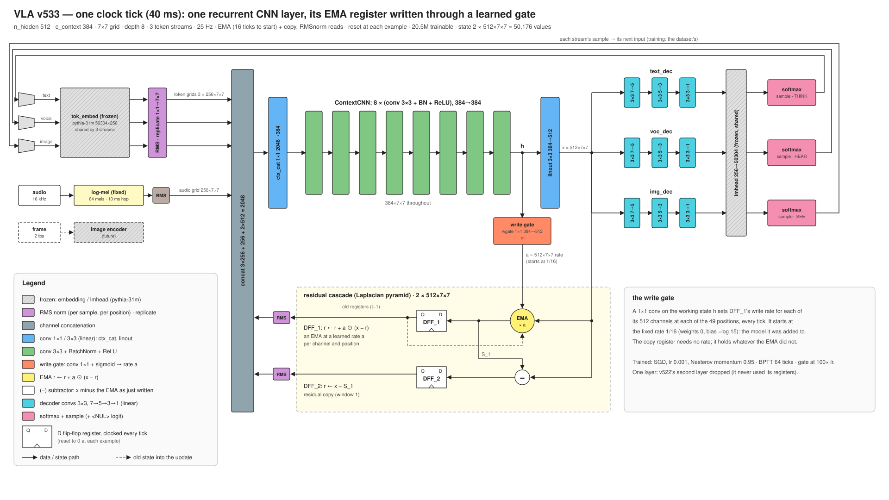

# VLA (recurrent CNN)

**Release v533, step 3,043,841** (761 M training tokens).

A language model with a fixed-size state and no positional encoding. It is one recurrent convolutional layer
with two 2-D registers of 512 × 7 × 7: a slow one, an average written through a learned gate (its rate, set
every tick for each channel and grid position, starts at 1/16, a 16-tick average), and a copy of the rest.
Every tick the layer reads the current token and its registers, writes the registers back, and its output is
decoded into the next token.

It is the text-trained core of a vision-language-action design. Most commercial applications for autonomous,
agile robots do not require superintelligence; they need conversational common sense, grounded in and modulated by
what the device perceives (sound, video, touch). To achieve superhuman hand-eye coordination, they need it at frame
rates up to 500 Hz, with low and deterministic latency for embedded control, on a power budget a battery can
supply. So the target is a single chip with no external DRAM: a CNN is parameter-efficient enough that every weight
fits in on-chip SRAM, where the weights stay programmable, and the fixed-size state makes every tick the same work.
Leaving out external memory also saves power: no DRAM chips to keep refreshed, no high-speed interface driving
signals between chips, and a weight read from on-chip SRAM takes on the order of a hundred times less energy than
one fetched from off-chip DRAM.

Code, functional spec and figures: [github.com/siliconperception/vla](https://github.com/siliconperception/vla)



## Use

```bash
git clone https://github.com/siliconperception/vla && cd vla && pip install -r requirements.txt
for p in "The colors of the rainbow are" \
         "The best way to learn a new language is" \
         "My grandmother's recipe for apple pie starts with" \
         "When you plant a vegetable garden, the first thing to do is" \
         "The history of the bicycle began in"; do
  python vla.py --pretrained --generate --n 120 --prompt "$p" --device cuda
done

# prompt tuning: fit the starting registers (weights frozen) until the model predicts the prompt,
# then continue from them; prints the cold and the tuned continuation
python vla.py --pretrained --generate --prompt_tune 200 --n 120 --prompt "The colors of the rainbow are" --device cuda
```

`--pretrained` downloads `model.safetensors` and `vla_args.json` (the settings the weights were trained with)
and restores both. The weights are not a `transformers` model; load them through `vla.py`. This repository
holds only the current release: each new one replaces the weights and this card, and earlier releases are not
kept.

## Model

| | |
|---|---|
| Parameters | 46.2 M: 20.5 M trained, 25.8 M frozen (token embedding and output layer from pythia-31m) |
| State | 2 registers × 512 × 7 × 7: 50,176 values, fixed in size |
| Registers | a gated average (rate learned per channel and position, starting at 1/16: 16 ticks, 0.64 s at 25 Hz) and a one-tick copy of the rest |
| Layer | 1×1 mix (2,048 → 384) of the token, sound and the two registers (RMS-normalized reads), 8 × (3×3 conv, BatchNorm, ReLU) at 384, 3×3 project (384 → 512), cascade write |
| Write gate | 1×1 conv (384 → 512) of the working channels and a sigmoid: the slow register's write rate |
| Readout | 3 decoders (text, voice, image), each a tree of three 3×3 convs and the frozen pythia-31m output layer |
| Tokenizer | pythia-31m BPE (50,304) plus a `<NUL>` token ("say nothing this tick") |

## Training

- 3,043,841 steps × 250 rows, one token per row per step (761 M tokens), SGD (at the end with Nesterov
  momentum 0.95, learning rate 0.001, the write gate at 100 × that). Truncated backpropagation through time over
  64 steps (16 before step 2,566,001); the loss is normalized per word rather than per token.
- Data: FineWeb sample-10BT, text only. Every document starts from a zero state.
- The configuration changed during training, always resuming from the latest weights: one layer with a 512-tick
  average and a 1,024-tick recall ring from scratch; the ring removed at step 1,065,312; the second layer added
  as the identity at 1,127,936; the slow windows shortened to 16 / 64 ticks by 1,456,944; the learning rate
  stepped down by half cosines, 0.02 → 0.01 → 0.005 → 0.0025 → 0.00125 → 0.001, from 1,501,536 to 2,263,328, with
  trials of momentum; layer 2's window 64 → 256 at 2,538,191. At 2,566,001 the second layer was removed (it
  never used its registers), the write gate added (starting at the fixed rate 1/16, the rate it replaced) and
  backpropagation lengthened to 64 steps, at learning rate 0.01; then momentum 0.5 from 2,960,001, Nesterov
  momentum 0.95 from 2,987,329 and learning rate 0.001 from 2,994,305. The
  [spec](https://github.com/siliconperception/vla/blob/main/docs/spec/README.md) lists every step.

## Evaluation (at the published step, 3,043,841)

The reference is EleutherAI's [pythia-70m](https://huggingface.co/EleutherAI/pythia-70m): a transformer of a
similar total size (70 M parameters, 19 M of them outside the token embedding and output layer) with the same
tokenizer, so losses per token compare directly. Pythia publishes checkpoints from early in training, so it is
shown at about this model's training tokens (steps 256 and 512 bracket it) as well as fully trained. Every model
is scored on the same documents and pairs, by the same rule.

| | **this model** | pythia-70m | pythia-70m | pythia-70m |
|---|---|---|---|---|
| training tokens | **761 M** | 537 M (step 256) | 1,074 M (step 512) | 300 B (final) |
| FineWeb held-out (100 documents, nats/token) | **4.580** | 6.355 | 5.467 | 3.731 |
| BabyLM 2026 dev (100 pieces, nats/token) | **4.564** | 5.718 | 4.984 | 3.250 |
| BLiMP (1,005 pairs from all 67 paradigms), % | **70.2** | 51.4 | 54.7 | 75.7 |
| ComVE (999 pairs, common sense), % | **65.0** | 57.1 | 59.7 | 69.7 |

Losses are the mean over documents of each document's mean loss per token, from a zero state (this model) or a
bare document start (pythia); a document with any token over 20 nats is counted as a runaway and left out
(4 % of the FineWeb documents for this model). Pythia was trained on the Pile, this model on FineWeb, so the FineWeb row is
in-domain for this model only. Matched tokens are not matched training: pythia's 537 M and 1,074 M tokens are only
256 and 512 optimizer updates of 2 M tokens each, still inside its learning-rate warm-up, while this model's are
3,043,841 updates of 250 tokens. Fully trained pythia-70m is the fair reference, and this model is still well
short of it. A pair is right when the model gives the correct sentence the lower total loss,
each sentence read without context. For scale on the pairs: babyllama-10m-2024 (trained on 10 M words) scores
70.0 / 63.7 and SmolLM2-135M 80.9 / 79.3.

## Samples

From the prompt in bold, with these weights. Locally fluent, not yet coherent:

> **My grandmother's recipe for apple pie starts with** a creamy teta sauce with cheese in its usual small butter and egg yolks, although they have been a tadota taste! You will love it too!

> **The colors of the rainbow are** the few parts of the image. The flower has a sparkling blue colour which I’ve written in my mind.

## Limits

A small model early in training: it writes locally fluent text that is often not factual or consistent. Not
instruction-tuned, not safety filtered beyond its training corpora. The voice and image decoders are present but
this model has been trained on text only.

## License

MIT, Copyright (c) 2024-2026 Silicon Perception Inc. The license covers the software and these weights and grants
no patent rights; see [PATENTS](https://github.com/siliconperception/vla/blob/main/PATENTS). Frozen third-party
weights inside: EleutherAI [pythia-31m](https://huggingface.co/EleutherAI/pythia-31m) embedding and output
layer (Apache-2.0).
