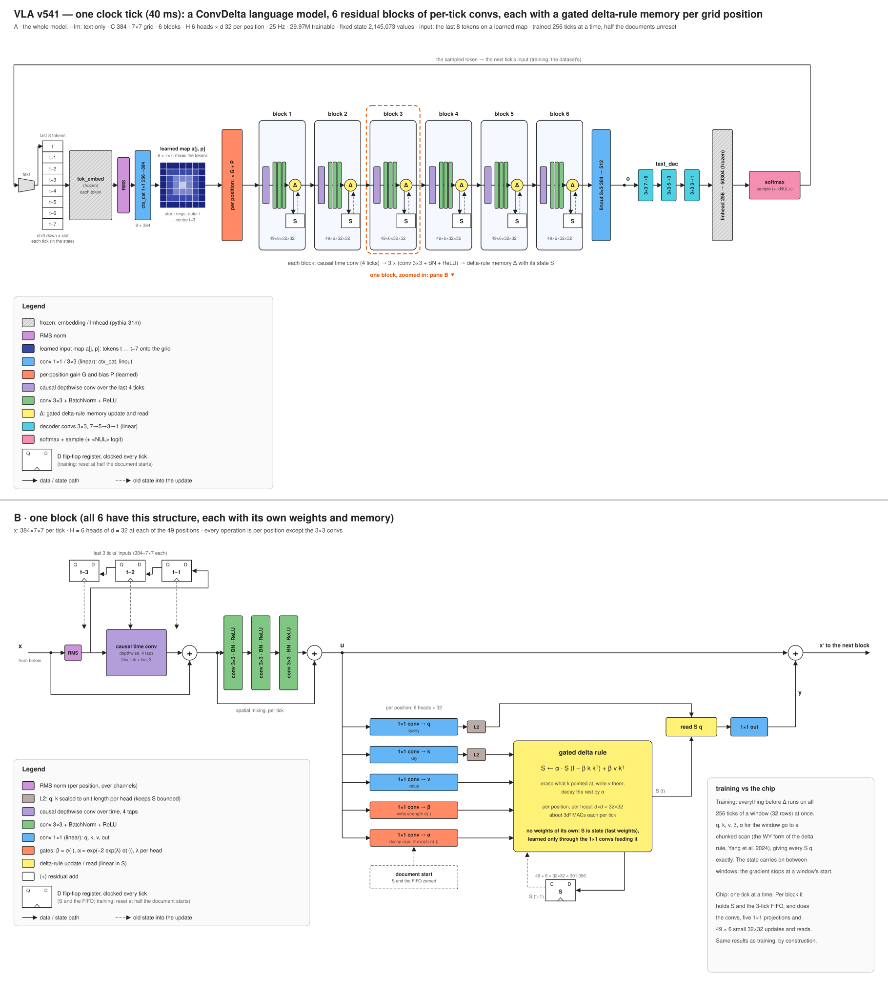

# VLA functional specification (model)

This is what the model computes, tick by tick, for the published configuration (`siliconperception/vla`,
run v541, a ConvDelta model). It specifies the function, not an implementation. `vla.py` is the reference:
where this text and the code disagree, the code is right and this text is a bug.

## Dimensions

| Symbol | Value | Meaning |
|---|---|---|
| S | 7 | grid side (positions P = S × S = 49) |
| C | 384 | channels of the working grid x, through every block |
| B | 6 | ConvDelta blocks, in series |
| H | 6 | memory heads per block at each grid position |
| d | 32 | key, query and value width of a head (each memory is d × d) |
| τ | 4 | taps of the causal time conv (this tick and the last 3) |
| n | 3 | 3×3 convs per block |
| G | 8 | tokens on the input grid (this one and the last 7) |
| N | 512 | width of the output grid o |
| E | 256 | token embedding width (pythia-31m) |
| V | 50,304 | vocabulary (pythia-31m BPE), plus `<NUL>` |
| f | 25 Hz | tick rate in training; one token per tick |

## State

Everything carried from one tick to the next, 2,145,073 values in all, fixed in size:

| Part | Shape | Values |
|---|---|---|
| Token history: the ids of the last 7 tokens (newest first, 0 = none) | 7 | 49 (one 7×7 channel; 7 used) |
| Per block b = 1 … 6: memories M_b | 49 positions × 6 heads × 32 × 32 | 301,056 |
| Per block: time-conv FIFO F_b, the last 3 ticks' RMS(x) | 3 × 384 × 7 × 7 | 56,448 |
| **Total** | 49 + 6 × 357,504 | **2,145,073** |

The state never grows. At the start of an example (a document, opened by `<NUL>`; see Training for the
exception) all of it is set to zero. At inference the model may also run without ever resetting: a robot
perceives continuously, and training teaches the model to let go of an old context on its own.

## Notation

- RMS(z) at a grid position: z / √(mean over channels of z² + ε), ε = 1e-6 (1e-12 for token embeddings).
- σ: the logistic sigmoid. ⊙: elementwise product. Conv k×k: zero padding unless "unpadded" is stated.
- BN: BatchNorm with no learned scale or shift; at inference it normalizes each channel with its stored
  running mean and variance.
- Every 1×1 conv acts at each grid position separately; only the k×k convs (k ≥ 3) mix neighbouring positions.

## One tick

Input: the current token id w_t (or `<NUL>`, "nothing this tick"). Output: the next-token distribution and the
sampled token.

### 1. Input grid

1. **History.** The 8 ids w_t, w_{t−1}, …, w_{t−7}: w_t from the input, the rest from the token history (a
   missing one, before 7 tokens have arrived since the last reset, is "none").
2. **Embed.** e_j = RMS(Embed(w_{t−j})) for j = 0 … 7, with the frozen pythia-31m embedding (V → E = 256);
   e_j = 0 for "none".
3. **Mix channels.** y_j = Conv1×1_in(e_j), 256 → 384, for each of the 8 tokens separately.
4. **Place on the grid.** x₀[c, p] = Σ_j a[j, p] · y_j[c], with a learned map a (8 × 7 × 7): every position p
   holds its own blend of the last 8 tokens. a starts as concentric square rings: w_t on the outer ring (24
   positions), w_{t−1} on the next (16), w_{t−2} on the next (8), w_{t−3} at the centre (1); w_{t−4} … w_{t−7} start
   at weight 0. Neighbouring positions therefore start out holding neighbouring moments, so the 3×3 convs see
   consecutive tokens side by side.
5. **Per-position gain and bias.** x = x₀ ⊙ G + P with learned G, P (each 384 × 7 × 7, initialized to 1 and 0).
6. **Update the token history:** shift in w_t, drop w_{t−7}.

### 2. Six ConvDelta blocks

Each block b = 1 … 6 maps x (384 × 7 × 7) to x′ of the same shape, using and updating its memories M_b and FIFO
F_b. All six have this structure, each with its own weights:

1. **Time conv.** r = RMS(x) at each position. u₀ = x + Σ_{j=0..3} κ_j ⊙ r_{t−j}, where r_{t−j} for j ≥ 1 comes
   from the FIFO and κ (4 × 384, one weight per lag and channel, initialized to 0) is depthwise: each channel
   sees only its own past. Then the FIFO shifts: F_b ← (r_t, r_{t−1}, r_{t−2}).
2. **Spatial mixing.** u = u₀ + Z(u₀), where Z is 3 × [Conv3×3 (384 → 384) → BN → ReLU]. The residual goes around
   all three convs.
3. **Projections**, at each position p, from u:
   - q, k, v = Conv1×1(u), 384 → 3 × 6 × 32: one query, key and value of width 32 per head; q and k are scaled
     to unit length per head (L2).
   - β = σ(g_β), α = exp(−2 · e^{λ_h} · σ(g_α)), with (g_β, g_α) = Conv1×1(u), 384 → 2 × 6 (weights and bias
     initialized to 0). β ∈ (0, 1) is the write strength. α ∈ (0, 1) is the decay; λ_h is a learned scalar per
     head, initialized so that e^{−λ_h} (the head's base window, in ticks) is log-spaced from 4 to 4,096 over
     the 6 heads.
4. **Gated delta rule**, for each position p and head h, on that position's memory M (32 × 32):

   M ← α · M · (I − β k kᵀ) + β v kᵀ

   That is: decay the whole memory by α, erase what it held at key k (in proportion β), and write v there.
   With unit k and β < 1 the erase step cannot grow M, so the memory stays bounded.
5. **Read.** o_h = M q, with the memory just written: 6 heads × 32 = 192 values per position.
6. **Output.** x′ = u + Conv1×1_out(o), 192 → 384 (weights and bias initialized to 0).

The memories have no weights of their own: M is state, a fast weight written every tick. It is shaped only by
the projections feeding it.

### 3. Output and decoding

1. **Project.** o = Conv3×3(x), 384 → N = 512 (linear).
2. **Decode**: a linear tree of unpadded convs, 3×3 (512 → 256, 7×7 → 5×5), 3×3 (256 → 256, 5×5 → 3×3),
   3×3 (256 → E, 3×3 → 1×1), then the frozen pythia-31m output layer (E → V), plus one trained logit for
   `<NUL>`. Embedding rows the tokenizer never uses are masked off.
3. **Emit.** Softmax, then min-p sampling: only tokens with at least p_min times the top token's probability
   are kept. p_min is stored with the weights; in training it is adjusted so that the model's own text,
   generated from `<NUL>`, scores a fluency of 100 (p_min = 0.0078 at step 2,560,000).
4. The sampled token is the next tick's input (in training, the dataset's next token is).

### Cost per tick

About 1.40 G multiply-accumulates per tick, 84 % of them in the 18 3×3 convs (65 M each). The 49 × 6 memory
updates and reads of a block take about 1.2 M. At 500 Hz that is 0.70 T multiply-accumulates per second, and
every tick does exactly the same work.

## Parameters

| Part | Parameters | Trained |
|---|---|---|
| Input: Conv1×1_in (256 → 384) | 98,688 | yes |
| Input map a, gain G, bias P | 38,024 | yes |
| Per block: time conv κ | 1,536 | yes |
| Per block: 3 × Conv3×3 (384 → 384) | 3,982,464 | yes |
| Per block: q, k, v (1×1, 384 → 576) | 221,760 | yes |
| Per block: β, α gates (1×1, 384 → 12) and λ | 4,626 | yes |
| Per block: Conv1×1_out (192 → 384) | 74,112 | yes |
| 6 blocks | 25,706,988 | yes |
| Project (3×3, 384 → 512) | 1,769,984 | yes |
| Decoder (tree and `<NUL>` logit) | 2,360,321 | yes |
| Token embedding | 12,877,824 | frozen |
| Output layer | 12,877,824 | frozen |
| **Total** | **55,729,653** (29,974,005 trained) | |

## The figure

[`docs/figures/vla_v541.svg`](../figures/vla_v541.svg) draws one clock tick (40 ms at 25 Hz) in two panes,
1920 × 2160. Colours encode the kind of operation, the same in both panes: grey hatched = frozen (embedding,
output layer); violet = RMS norm; dark blue = the learned input map; blue = linear convs (1×1 or 3×3);
orange = per-position gain and bias, and the β, α gates; lavender = the causal time conv; green = conv 3×3 +
BatchNorm + ReLU; yellow = the delta-rule memory (Δ) and its read; brown = L2 normalization; cyan = the decoder
convs; pink = softmax and sampling. A box drawn like a D flip-flop (Q, D and a clock notch) is state: a register
written once per tick. Solid arrows are data and state paths; dashed arrows carry the old state into an update.

### Pane A (top): the whole model

The subtitle line gives the configuration: `--lm` (text only), C 384, the 7×7 grid, 6 blocks, H 6 heads × d 32
per position, 25 Hz, 29.97 M trained parameters, a fixed state of 2,145,073 values, the input as the last 8
tokens on a learned map, and training on 256-tick windows with half of the documents unreset.

Left to right:

1. **text** enters at the left through an input mux. A column of 8 slots, labelled **t, t−1, … t−7** under
   "last 8 tokens", is the token history; the note "shift down a slot each tick (in the state)" says that the 7
   older slots are state.
2. **tok_embed (frozen, each token)**, hatched grey: each of the 8 tokens is embedded separately.
3. **RMS**, violet: each embedding scaled to unit RMS.
4. **ctx_cat 1×1 256→384**, blue, labelled **8 × 384** below: the per-token channel mix (input step 3).
5. **learned map a[j, p]**, a 7×7 icon of blue squares, labelled "8 × 7×7, mixes the tokens" and "start: rings,
   outer t … centre t−3": the shades show the starting rings, darkest (t) outside.
6. **per position: × G + P**, orange: the learned gain and bias (input step 5).
7. **block 1 … block 6**, six rounded light-blue boxes in series. Inside each, left to right: a lavender bar
   (the time conv), three green bars (the three conv 3×3 + BN + ReLU), and a yellow circle **Δ** (the delta-rule
   memory). Below each Δ is a flip-flop **S**, its memory state: a solid arrow from Δ down into S (the write) and
   a dashed arrow from S back up into Δ (the old state it updates). Under each block, **49×6×32×32** is the size
   of that block's memory. The caption reads "each block: causal time conv (4 ticks) → 3 × (conv 3×3 + BN +
   ReLU) → delta-rule memory Δ with its state S".
8. A dashed orange frame around block 3, "one block, zoomed in: pane B ▼", points to pane B.
9. **linout 3×3 384 → 512**, blue: the projection to o (the dot labelled **o**).
10. **text_dec**: three cyan bars, **3×3 7→5**, **3×3 5→3**, **3×3 3→1**, the decoder tree.
11. **lmhead 256 → 50304 (frozen)**, hatched grey.
12. **softmax, sample (+ \<NUL\>)**, pink. A line from it runs along the top back to the input mux, labelled
    "the sampled token → the next tick's input (training: the dataset's)".

Below the diagram, the **Legend** lists these colours, the flip-flop symbol ("D flip-flop register, clocked
every tick (training: reset at half the document starts)") and the two arrow styles.

### Pane B (bottom): one block

Its title says all 6 blocks have this structure, each with its own weights and memory; the subtitle gives x as
384×7×7 per tick, H = 6 heads of d = 32 at each of the 49 positions, and that every operation is per position
except the 3×3 convs.

Left to right along the main line:

1. **x from below** (the previous block's output, or the input grid for block 1) splits: one branch goes to
   **RMS** (violet), the other runs underneath as the residual.
2. RMS feeds the **causal time conv** (lavender; "depthwise, 4 taps, this tick + last 3") and, upward, a chain of
   three flip-flops **t−1 → t−2 → t−3**, labelled "last 3 ticks' inputs (384×7×7 each)": the FIFO F_b, which
   holds RMS(x). Dashed arrows bring each stored tick down into the time conv. The time conv's output and the
   residual meet at a **(+)**: u₀.
3. Three green bars, **conv 3×3 · BN · ReLU**, in series, with a residual line underneath from before the first
   to a **(+)** after the third, labelled "spatial mixing, per tick". The sum is **u**.
4. From u, the main line runs straight right to a final **(+)** and on as **x′ to the next block**.
5. Below, u fans out into five 1×1 convs ("per position: 6 heads × 32"): **1×1 conv → q** (query) and **1×1
   conv → k** (key) in blue, each followed by a brown **L2** box; **1×1 conv → v** (value) in blue;
   **1×1 conv → β** ("write strength σ(·)") and **1×1 conv → α** ("decay exp(−2 exp(λ) σ(·))") in orange.
6. k, v, β and α enter the large yellow **gated delta rule** box: "S ← α · S (I − β k kᵀ) + β v kᵀ", "erase what
   k pointed at, write v there, decay the rest by α", "per position, per head: d×d = 32×32, about 3d² MACs each
   per tick", and in bold "no weights of its own: S is state (fast weights), learned only through the 1×1 convs
   feeding it".
7. Under it, the flip-flop **S**, "49 × 6 × 32×32 = 301,056", with a solid arrow in from the update and a dashed
   arrow, labelled **S (t−1)**, back into it.
8. The updated memory, **S (t)**, goes up to **read S q** (yellow), which also takes q from the L2 box along the
   top. The read goes to **1×1 out** (blue), then up, labelled **y**, into the final (+).
9. A dashed box, **document start: S and the FIFO zeroed**, sits under the α projection.
10. The panel **training vs the chip**, at the right: in training, everything before Δ runs on all 256 ticks of
    a window (32 rows) at once, and q, k, v, β, α for the window go to a chunked scan (the WY form of the delta
    rule) that gives every S q exactly; the state carries on between windows, and the gradient stops at a
    window's start. On the chip it runs one tick at a time: per block it holds S and the 3-tick FIFO, and does
    the convs, five 1×1 projections, and 49 × 6 small 32×32 updates and reads, with the same results as
    training, by construction.

Pane B's legend repeats the colours used there and adds: L2 (q, k scaled to unit length per head, which keeps S
bounded), the gate formulas β = σ(·), α = exp(−2 exp(λ) σ(·)) with λ per head, and (+) as the residual add.

## Training (for reference)

- From scratch, in one configuration, to step 2,560,000. A step is one tick (one token) for each of 32 rows,
  so 81.9 M tokens.
- Data: FineWeb sample-10BT, text only.
- Each row trains on windows of 256 consecutive ticks. Within a window the convs run on all ticks at once, and
  the memories are trained over the whole window by an exact chunked parallel scan. The state carries on from
  one window into the next, but the gradient stops at a window's start. Each block's activations are recomputed
  in the backward pass to save memory.
- **Document starts:** in training, a document start resets the state with probability 0.5. In the other half
  the previous, unrelated document's memories carry straight on, marked only by the `<NUL>` separator, as when
  a robot's perception jumps to a new scene, task or speaker. The model has to learn to let go of stale context
  itself, through α and β, which see the input. Evaluations reset at every document.
- Optimizer: AdamW, β (0.9, 0.95), no weight decay, no gradient clipping. The learning rate rises from 1e-5 to
  1e-4 over the first 256,000 steps (a half cosine, 1,000 updates) and is then held. Cross-entropy is
  normalized per word, not per token.
- Frozen: the token embedding and the output layer (pythia-31m).
- Numerics: the convs run in bf16 on the GPU and the scan in TF32. In float64, the parallel scan equals one-tick
  stepping to about 1e-14.

## References

The model combines ideas from these papers:

- **Delta-rule fast-weight memory:** I. Schlag, K. Irie, J. Schmidhuber, *Linear Transformers Are Secretly Fast
  Weight Programmers* (2021), [arXiv:2102.11174](https://arxiv.org/abs/2102.11174).
- **Matrix-valued recurrent state, linear attention as an RNN:** A. Katharopoulos et al., *Transformers are RNNs:
  Fast Autoregressive Transformers with Linear Attention* (2020), [arXiv:2006.16236](https://arxiv.org/abs/2006.16236).
- **Gated delta rule (decay α with write strength β, L2-normalized q and k):** S. Yang, J. Kautz,
  A. Hatamizadeh, *Gated Delta Networks: Improving Mamba2 with Delta Rule* (2024),
  [arXiv:2412.06464](https://arxiv.org/abs/2412.06464).
- **Chunked parallel training of the delta rule (WY form):** S. Yang, B. Wang, Y. Zhang, Y. Shen, Y. Kim,
  *Parallelizing Linear Transformers with the Delta Rule over Sequence Length* (2024),
  [arXiv:2406.06484](https://arxiv.org/abs/2406.06484).
- **Data-dependent scalar decay per head:** T. Dao, A. Gu, *Transformers are SSMs: Generalized Models and
  Efficient Algorithms Through Structured State Space Duality* (2024), [arXiv:2405.21060](https://arxiv.org/abs/2405.21060).
- **Short causal depthwise conv before the memory:** D. Y. Fu et al., *Hungry Hungry Hippos: Towards Language
  Modeling with State Space Models* (2022), [arXiv:2212.14052](https://arxiv.org/abs/2212.14052); A. Gu, T. Dao,
  *Mamba: Linear-Time Sequence Modeling with Selective State Spaces* (2023), [arXiv:2312.00752](https://arxiv.org/abs/2312.00752).
- **Recurrent state at every position of a conv grid:** X. Shi et al., *Convolutional LSTM Network: A Machine
  Learning Approach for Precipitation Nowcasting* (2015), [arXiv:1506.04214](https://arxiv.org/abs/1506.04214).
- **Residual blocks:** K. He et al., *Deep Residual Learning for Image Recognition* (2015),
  [arXiv:1512.03385](https://arxiv.org/abs/1512.03385).
- **BatchNorm:** S. Ioffe, C. Szegedy, *Batch Normalization: Accelerating Deep Network Training by Reducing
  Internal Covariate Shift* (2015), [arXiv:1502.03167](https://arxiv.org/abs/1502.03167).
- **RMS normalization:** B. Zhang, R. Sennrich, *Root Mean Square Layer Normalization* (2019),
  [arXiv:1910.07467](https://arxiv.org/abs/1910.07467).
- **Tokenizer, frozen embedding and output layer, and the reference model:** S. Biderman et al., *Pythia: A Suite
  for Analyzing Large Language Models Across Training and Scaling* (2023), [arXiv:2304.01373](https://arxiv.org/abs/2304.01373).
- **Optimizer:** I. Loshchilov, F. Hutter, *Decoupled Weight Decay Regularization* (2017),
  [arXiv:1711.05101](https://arxiv.org/abs/1711.05101).
- **Training data:** G. Penedo et al., *The FineWeb Datasets: Decanting the Web for the Finest Text Data at
  Scale* (2024), [arXiv:2406.17557](https://arxiv.org/abs/2406.17557).
